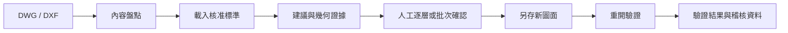

<div align="center">

# LayerLab

**讓每一次 CAD 圖層標準化，都有證據、人工決策與驗證紀錄。**

Windows 本機圖層審核工作台 · AutoCAD 2026 原生 DWG · DXF 相容流程

[下載 v1.0.0-preview.4](https://github.com/whos-dwg/LayerLab/releases/tag/v1.0.0-preview.4) · [快速開始](#快速開始) · [操作手冊](src/dwg-layer-standardizer/README.zh-TW.md) · [資料契約](src/dwg-layer-standardizer/references/CONTRACTS.md) · [參與開發](CONTRIBUTING.md)

</div>

LayerLab 協助整理來自不同顧問、廠商與專案的 DWG／DXF 圖層。先讀取圖面內容，再依使用者提供的標準建立映射建議；由人員確認每個來源層的去向，最後另存副本並驗證結果。

圖層名稱只是線索。物件類型、文字、圖塊、空間分布與幾何預覽，才是判讀依據。

*下方截圖拍攝於前一版，用於說明基礎審核流程；新功能以操作手冊為準。*


*使用儲存庫內附示範 DXF 與示範標準拍攝。*

## 目錄

- [功能](#功能)
- [處理流程](#處理流程)
- [下載目前預覽版](#下載目前預覽版)
- [快速開始](#快速開始)
- [命令列操作](#命令列操作)
- [設定與資料](#設定與資料)
- [限制與保護](#限制與保護)
- [開發與文件](#開發與文件)
- [授權](#授權)

## 功能

| 功能 | 使用方式與價值 |
| --- | --- |
| 原生 DWG 盤點 | 透過 AutoCAD 2026 讀取模型空間、配置及圖塊定義，不經 DXF 中轉 |
| 內容證據 | 檢視圖層屬性、物件類型、圖塊與文字樣本、幾何預覽 |
| 映射編排台 | 來源與目標獨立搜尋，支援跨頁勾選、批次指定與單層操作 |
| 明確人工核准 | 建議、暫定目標與已確認決策分開；拖放不等於核准 |
| 審核進度保存 | 瀏覽器保存草稿；恢復時核對盤點與標準指紋，並處理分頁衝突 |
| 可選模型建議 | 設定 API 後分析有界內容證據，保留稽核 JSON；仍需人工採用 |
| 副本與驗證 | DWG 依序經獨立程序寫入、重開清理來源層、再次重開驗證 |
| DXF 相容 | 使用 ezdxf 產生副本並回讀驗證 |

逐物件判讀可依文字、尺寸、圖塊語意與有限幾何證據提出建議；可選 DWS 匯出需另通過 AutoCAD 桌面實際載入驗證，失敗不影響已驗證 DWG。

## 處理流程



例如，同樣名為 `WALL` 的來源層，仍需檢視內容並指定公司標準中的目標層；選擇目標後先成為暫定映射，確認後才可進入轉換。

## 下載目前預覽版

目前公開預覽版為 [v1.0.0-preview.4](https://github.com/whos-dwg/LayerLab/releases/tag/v1.0.0-preview.4)，已包含建置警告、辨識相容性、Git hooks 與 DWS 回讀清理修正，並完成實測。

- [下載原始碼 ZIP](https://github.com/whos-dwg/LayerLab/releases/download/v1.0.0-preview.4/LayerLab-v1.0.0-preview.4-source.zip)
- [下載 SHA256SUMS.txt](https://github.com/whos-dwg/LayerLab/releases/download/v1.0.0-preview.4/SHA256SUMS.txt)
- [目前操作手冊](src/dwg-layer-standardizer/README.zh-TW.md) · [此版本驗證紀錄](https://github.com/whos-dwg/LayerLab/blob/v1.0.0-preview.4/docs/VALIDATION.md)

將 ZIP 與校驗檔下載至同一資料夾，以 PowerShell 執行 `Get-FileHash .\LayerLab-v1.0.0-preview.4-source.zip -Algorithm SHA256`，核對結果與 `SHA256SUMS.txt` 一致。這是原始碼包，需依下列步驟安裝相依套件；舊版附件只供歷史參考。

## 快速開始

### 環境需求

- Windows；原生 DWG 流程需 AutoCAD 2026 Update 1.2 或更新版本（.NET 10）。
- Python 與 pip；本次已在 Python 3.13.13 驗證。其他版本尚未驗證。
- 建置原生 adapter 需要 .NET 10 SDK；目前專案目標為 `net10.0-windows`、x64。
- 原生整合目前使用 `C:\Program Files\Autodesk\AutoCAD 2026`；其他安裝位置需調整整合程式與參考路徑。
- Node.js 僅用於前端檢查及測試。

下載上方 v1.0.0-preview.4 ZIP 並解壓，進入包含 `README.md` 與 `src` 的 `LayerLab` 資料夾，於此開啟 PowerShell：

```powershell
python -m venv .venv
.\.venv\Scripts\python.exe -m pip install -r src/dwg-layer-standardizer/requirements.txt
.\.venv\Scripts\python.exe -m pip check
$env:CADLAYER_STANDARD = (Resolve-Path "src/dwg-layer-standardizer/standards/DEMO_STANDARD.json").Path
.\.venv\Scripts\python.exe src/dwg-layer-standardizer/scripts/run.py health
.\.venv\Scripts\python.exe -m uvicorn cadlayer.app:app --app-dir src/dwg-layer-standardizer --host 127.0.0.1 --port 8765
```

保持 PowerShell 開啟，手動在瀏覽器開啟 `http://127.0.0.1:8765`；結束時於 PowerShell 按 Ctrl+C。若 8765 已被使用，將命令的連接埠與瀏覽器網址一併改為 8877。公開原始碼包使用此 uvicorn 入口，可避免本機既有 skill 的標準與同步設定介入。`run.py serve` 與雙擊啟動器另有已安裝 skill 的同步檢查，適用條件見操作手冊。

`health` 只檢查 adapter 與執行器是否存在，不代表已完成原生建置或圖面轉換。首次讀取 DWG 時會建置缺少的 adapter，需可用的 .NET SDK 與 NuGet 套件來源；DXF 示範不需要 AutoCAD 或 .NET。

若要重現本次套件版本，可將安裝命令的 requirements 路徑改為 `docs/requirements-validated.txt`。

上例使用內附示範標準；正式作業前，請將 `CADLAYER_STANDARD` 改為已核准標準 JSON 的絕對路徑。另內附 48 層的匿名化預設標準 `src/dwg-layer-standardizer/standards/DEFAULT_STANDARD.json`，保留圖層名稱、CAD 屬性、別名、分類與命名規則，不含公司名稱及來源工作紀錄。

1. 點選「開啟示範 DXF」，或匯入 DWG、DXF／`cad-layer-inventory/v1` 盤點 JSON。
2. 檢查目前標準，查看來源層的內容證據與幾何。
3. 指定目標並確認映射，或明確選擇保留；完成所有非保護來源層的決策。
4. 匯出映射供留存，再執行另存與驗證。
5. 檢查驗證報告及輸出圖面。

匯入盤點 JSON 僅供審核及匯出映射；要另存圖面，請直接匯入原始 DWG 或 DXF。

### 完整示範操作

示範載入後應顯示 **8 個來源層、18 個物件、6 層待審、2 層保護**。逐一選取 `A-WALL`、`WALL-NEW`、`A-DOOR`、`A-TEXT`、`MISC-05`，核對證據後按各層「確認」；`EMPTY-01` 選擇「保留目前圖層」。此時應為 6/6 已審核、0 待審。

點選「匯出映射」，由結果連結下載 Mapping JSON；再點「另存 DXF 並驗證」。成功後顯示物件數 18 → 18、原始檔未修改，並提供輸出 DXF、mapping.json 與 validation.json 下載連結。


最新建置已達 0 警告、0 錯誤；合成樣本 DWS 桌面實際載入與獨立重開驗證通過。

本次實際驗證範圍、套件版本與限制見[驗證紀錄](docs/VALIDATION.md)。

### DWG 與可選 DWS

匯入 DWG、完成映射核准後，點選「另存 DWG 並驗證」。系統依序以三個獨立 AutoCAD 程序寫入副本、重開清理來源層、再次重開驗證；成功後可儲存標準化 DWG。

需要重用整層映射時，先啟動 AutoCAD 2026 桌面，確認沒有執行中的命令，再點選「匯出 DWS」。系統會在可丟棄的來源副本實際載入及套用 DWS、儲存，再由獨立 Core Console 對驗證副本清理仍存在的核准來源層，最後由另一個新程序重開驗證。通過後才提供 DWS 與驗證報告；可用 AutoCAD `LAYTRANS → Load` 載入。此選配不支援逐物件例外，DXF 也不提供 DWS。失敗時保留已驗證主 DWG，並顯示「DWG 已完成、DWS 未產生」。

## 命令列操作

以下命令從 `src/dwg-layer-standardizer` 目錄執行，並使用已安裝相依套件的 Python。若依快速開始建立了根目錄 `.venv`，請將下方 `python` 改為 `..\..\.venv\Scripts\python.exe`：

```powershell
python scripts/run.py health
python scripts/run.py scan --source input.dwg --standard standard.json --out scan-job
python scripts/run.py suggest --inventory scan-job/inventory.json --standard standard.json --out review-job
python scripts/run.py convert --source input.dwg --inventory scan-job/inventory.json --standard standard.json --mapping approved-mapping.json --out verified-output
```

請換成實際輸入路徑；`approved-mapping.json` 必須是人工完成的決策，輸出資料夾必須尚未存在。完整契約見[資料契約](src/dwg-layer-standardizer/references/CONTRACTS.md)。

## 設定與資料

| 環境變數 | 用途 |
| --- | --- |
| `CADLAYER_STANDARD` | 指定圖層標準 JSON |
| `OPENAI_API_KEY` | 啟用可選的模型語意建議 |
| `CADLAYER_AI_MODEL` | 指定模型；目前程式預設為 `gpt-5-mini` |
| `CADLAYER_AI_BASE_URL` | 覆寫模型 API base URL |

未設定 `CADLAYER_STANDARD` 時，工作台載入 `DEFAULT_STANDARD.json`。若要在快速開始環境改用預設標準，將環境變數路徑的 `DEMO_STANDARD.json` 改成 `DEFAULT_STANDARD.json`，然後重新啟動服務。範例截圖與驗證使用 DEMO 標準；預設標準中的非連續線型須已存在於待處理圖面，缺少時會停止轉換。

標準格式為 `cad-layer-standard/v1`。ACI 範圍為 1–255，線寬單位為 1/100 mm；目標線型需存在於來源圖面。

模型功能會傳送標準及有界的圖層證據，包括可能含有專案資訊的文字、圖塊與屬性樣本，不傳送原始 DWG。啟用前請確認這些資料可提供給設定的 API 服務。API 金鑰請透過環境變數設定。

草稿儲存於目前瀏覽器及網址，不會跨裝置同步。重要決策請匯出映射留存。

## 限制與保護

- 保留來源檔，以 SHA-256 核對來源完整性；不覆寫來源或既有輸出目錄。
- `0`、`DEFPOINTS` 與 XREF dependent layers 只能保留。
- 不自動分解圖塊，不強制將物件 override 改為 ByLayer。
- DWG 可處理可編輯圖塊定義；DXF writer 不修改圖塊定義。
- DWG 驗證涵蓋具權威性的物件 handle、圖層、型別、數量、非圖層簽章及目標層屬性；其中包含尺寸擁有者 `Dimension`。AutoCAD 再生的 `*D` 尺寸顯示快取不作為權威資料，重開驗證不逐一開啟，以避開 AutoCAD 2026 在大型圖面上的原生崩潰；詳見[原生 adapter](src/dwg-layer-standardizer/integrations/autocad-2026-native/README.md)。
- 映射不完整、來源變更、線型缺少、CAD 執行錯誤或回讀不符會停止；未通過驗證的 DWG 輸出會移除。
- 本工具處理圖層標準化，輸出仍需依專案要求進行 CAD 專業檢查。

## 開發與文件

```text
src/dwg-layer-standardizer/
├── cadlayer/       Python API、契約、建議與 CAD 路由
├── ui/             本機 Web 工作台
├── scripts/        CLI 與已安裝介面同步
├── integrations/   AutoCAD 2026 原生整合
├── standards/      示範標準
├── references/     資料契約
└── examples/       DXF 示範
```

- [完整操作手冊](src/dwg-layer-standardizer/README.zh-TW.md)
- [原生 DWG adapter](src/dwg-layer-standardizer/integrations/autocad-2026-native/README.md)
- [貢獻指南](CONTRIBUTING.md)
- [發布文案與準備事項](docs/GITHUB_RELEASE.md)

本版原始碼包包含 `tools/` 測試腳本及 `tools/git-hooks` 的三個同步 hooks。自動同步另需 Git checkout；ZIP 獨立執行請使用快速開始的 uvicorn 入口。舊 preview.3 缺少三個 hooks，造成兩項同步測試失敗；本版已補齊。

## 授權

本專案採用 [MIT License](LICENSE)。AutoCAD 為 Autodesk 產品，使用者需自行具備適用的安裝與授權。

## 參考

README 的導覽、功能表、快速開始與流程圖編排參考 [Awesome README](https://github.com/matiassingers/awesome-readme) 收錄的呈現方式。
